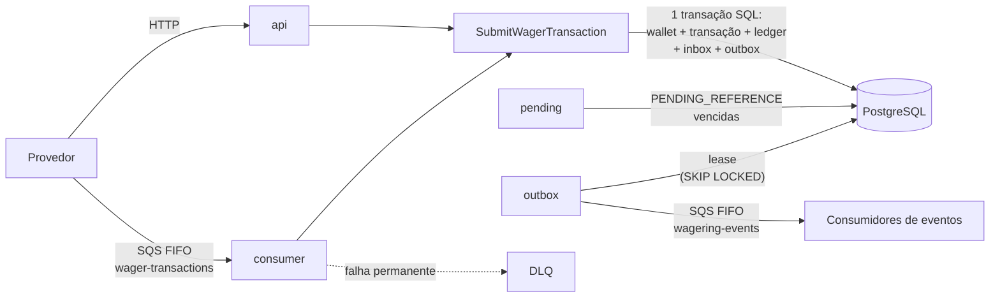
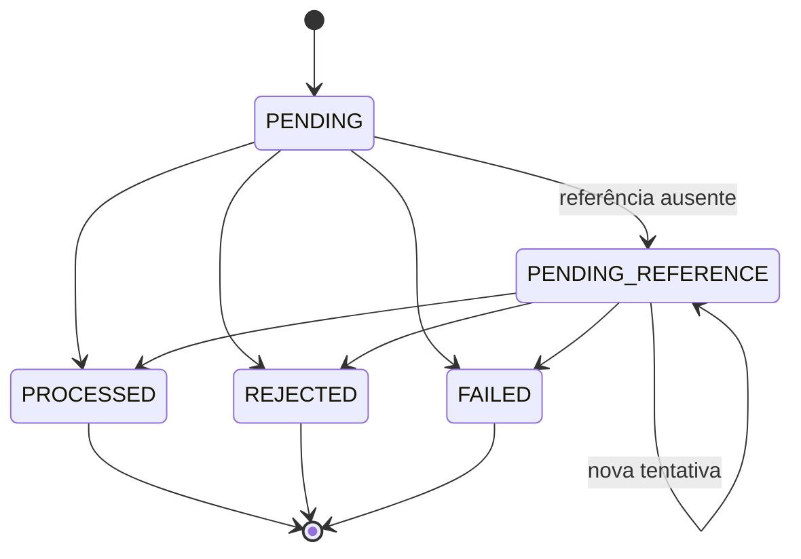

# Arquitetura

Este documento registra **como** o Distributed Wagering Processor garante as invariantes financeiras e **por que** cada decisão foi tomada. Ele cobre as alternativas consideradas, os trade-offs aceitos e as limitações conhecidas. Setup, comandos e exemplos de uso estão no [README](README.md).

## Sumário

1. [Visão geral](#1-visão-geral)
2. [Domínio](#2-domínio)
3. [Persistência e invariantes no banco](#3-persistência-e-invariantes-no-banco)
4. [Concorrência](#4-concorrência)
5. [Idempotência](#5-idempotência)
6. [Mensageria: inbox, outbox e referências pendentes](#6-mensageria-inbox-outbox-e-referências-pendentes)
7. [Contratos: status HTTP e failureCode](#7-contratos-status-http-e-failurecode)
8. [Resiliência](#8-resiliência)
9. [Autenticação](#9-autenticação)
10. [Decisões (ADRs)](#10-decisões-adrs)
11. [Interpretações do enunciado](#11-interpretações-do-enunciado)
12. [Trade-offs e limitações](#12-trade-offs-e-limitações)
13. [Em produção na AWS](#13-em-produção-na-aws)
14. [Uso de IA](#14-uso-de-ia)

---

## 1. Visão geral

O serviço recebe operações de provedores de jogos (BET, WIN, LOSS, REFUND, ROLLBACK) por **HTTP** e por **SQS**. Ele as aplica a wallets com saldo materializado e ledger auditável, e publica eventos de integração. A entrega é **at-least-once** de ponta a ponta. Por isso, toda garantia (não duplicar efeito, não perder evento, não permitir saldo negativo) fica no **PostgreSQL**, nunca na memória do processo nem no broker.

**Um codebase, uma imagem, quatro papéis** (`APP_ROLES`): `api`, `consumer`, `outbox` e `pending`. Cada instância roda os papéis configurados, todos por padrão. Em produção, cada papel escala de forma independente. Os processos não compartilham nada em memória: todos os testes de concorrência e resiliência rodam com **processos reais** que compartilham apenas o PostgreSQL e o SQS.

**Camadas** (dependências apontam para dentro):

| Camada           | Conteúdo                                                                                       | Depende de    |
| ---------------- | ---------------------------------------------------------------------------------------------- | ------------- |
| `domain`         | `Money`, `Wallet`, `WagerTransaction`, `WagerTransactionProcessor`, eventos, inbox/outbox      | nada          |
| `application`    | Casos de uso, portas (`UnitOfWork`, repositórios, `Clock`, `IdGenerator`, `Metrics`, `Logger`) | `domain`      |
| `infrastructure` | MikroORM, SQS, pino, Prometheus, configuração, adaptadores das portas                          | `application` |
| `interfaces`     | Controllers HTTP, consumidor SQS, workers, mapeamento de erros                                 | `application` |

---

## 2. Domínio

### Money

- `Money` é **imutável** e usa `decimal.js` com uma configuração isolada (precisão 40, `ROUND_HALF_EVEN`). Assim, nenhuma configuração global altera a aritmética monetária.
- A entrada é sempre uma **string decimal com exatamente 2 casas**: `^(0|[1-9]\d{0,17})\.\d{2}$`. `NaN`, `Infinity`, notação científica, sinal, espaços, `"25.5"` e `"25"` são rejeitados por construção, porque não casam com o padrão.
- Como toda entrada tem no máximo 2 casas, soma e subtração são sempre exatas e **nunca há arredondamento**.
- No banco, o valor fica em `numeric(20, 2)`, com a moeda em coluna separada (`char(3)`), e volta como `Money` na leitura. Nas fronteiras (HTTP, SQS, eventos), o valor trafega como string.

### WagerTransaction: máquina de estados

- As transições ficam encapsuladas em `WagerTransaction`. Qualquer outra transição lança `InvalidTransactionStateError`.
- `PENDING` existe só durante a transação SQL que cria o registro. O que é confirmado no banco já é o resultado da avaliação.
- O schema também amarra cada campo ao estado em que ele faz sentido:
  - `failure_code` existe se e somente se o estado é `REJECTED` ou `FAILED`;
  - `processed_at` existe se e somente se o estado é `PROCESSED`;
  - `next_attempt_at` existe se e somente se o estado é `PENDING_REFERENCE`.

### Efeito de cada operação

| Kind       | Efeito no saldo         | Referência                                 |
| ---------- | ----------------------- | ------------------------------------------ |
| `OPENING`  | crédito (interno)       | proibida                                   |
| `BET`      | débito                  | proibida                                   |
| `WIN`      | crédito                 | opcional, só para `BET` (D7)               |
| `LOSS`     | nenhum (sem lançamento) | opcional, só para `BET` (D7)               |
| `REFUND`   | crédito                 | obrigatória, só para `BET`                 |
| `ROLLBACK` | inverso da referência   | obrigatória, para `BET`, `WIN` ou `REFUND` |

O `WagerTransactionProcessor` aplica as regras do §7 do enunciado nesta ordem:

1. contexto da wallet: jogador e moeda;
2. resolução da referência, que verifica existência, estado, tipo, contexto (provider, player, wallet, moeda e rodada), valor igual e reversão única;
3. efeito no saldo.

Ele é **lógica pura de domínio**: altera os agregados e devolve o resultado, e quem persiste é o caso de uso. Uma aposta sem saldo é rejeitada com `INSUFFICIENT_FUNDS`; uma **reversão** que deixaria o saldo negativo é rejeitada com um código distinto, `REVERSAL_INSUFFICIENT_FUNDS` (regra 7.9).

### Wallet e ledger

- A `Wallet` só muda o saldo por `credit`/`debit`. Cada mudança gera exatamente um `WalletLedgerEntry` com o saldo anterior, o saldo posterior e a nova `version`.
- A `version` começa em 1 e **só incrementa quando o saldo muda**. Por isso, ela funciona como número de sequência do ledger.
- Um saldo inicial positivo gera uma transação `OPENING`, do provider reservado `internal`, e o lançamento de crédito correspondente.

### Eventos

- Os eventos estendem a classe abstrata `IntegrationEvent`, com uma subclasse concreta por evento.
- O envelope traz `eventId`, `eventType`, `aggregateId`, `occurredAt`, `correlationId`, `causationId` e `data`. Em `data`, o dinheiro vai como `MoneyProps` (string), nunca como instância.

| Evento                             | Quando                                                         |
| ---------------------------------- | -------------------------------------------------------------- |
| `WagerTransactionProcessed`        | toda transação aplicada, inclusive `LOSS`                      |
| `WalletBalanceChanged`             | **somente** quando há lançamento no ledger                     |
| `WagerTransactionRejected`         | rejeição por regra de negócio (inclusive tentativas esgotadas) |
| `WagerTransactionPendingReference` | ao entrar em `PENDING_REFERENCE` (não a cada nova tentativa)   |
| `WagerTransactionFailed`           | ao entrar em `FAILED` (além dos eventos mínimos do enunciado)  |

---

## 3. Persistência e invariantes no banco

**ORM: MikroORM 7** (D1). É a opção preferencial do enunciado, oferece Unit of Work e Identity Map, `transactional()` e `LockMode` (incluindo `FOR UPDATE SKIP LOCKED`). Os agregados de domínio não carregam metadados do ORM: o mapeamento é feito por `EntitySchema` e mappers explícitos na camada de persistência.

**Unit of Work.** Cada caso de uso roda em `UnitOfWork.run()`, que:

- faz `em.fork()`, para ter um Identity Map isolado por requisição ou mensagem;
- abre a transação SQL e faz flush de tudo no sucesso, ou rollback de tudo em caso de erro;
- **traduz erros de persistência** em erros de aplicação, de modo que os casos de uso nunca veem tipos do ORM.

O isolamento padrão é `READ COMMITTED`. A reconciliação usa `REPEATABLE READ` somente leitura, para ler saldo e ledger no mesmo snapshot.

**Migrations escritas à mão em SQL** (D21). Constraints, índices parciais e triggers fazem parte do design avaliado, então não são geradas automaticamente.

### O banco como última linha de defesa

Mesmo com um bug no código, o banco recusa os estados que quebram as invariantes:

| Garantia                            | Mecanismo                                                                                                                                                                                                                                                 |
| ----------------------------------- | --------------------------------------------------------------------------------------------------------------------------------------------------------------------------------------------------------------------------------------------------------- |
| Saldo nunca negativo                | `CHECK (balance >= 0)` em `wallets` e nos saldos do ledger                                                                                                                                                                                                |
| Ledger imutável                     | triggers recusam `UPDATE`, `DELETE` e `TRUNCATE` em `wallet_ledger_entries`                                                                                                                                                                               |
| Lançamento coerente                 | `CHECK`: `balance_after = balance_before ± amount`, conforme a direção                                                                                                                                                                                    |
| Ledger sem lacunas                  | `UNIQUE (wallet_id, wallet_version)`: uma entrada por versão                                                                                                                                                                                              |
| Um lançamento por transação         | `UNIQUE (wallet_id, transaction_id)`                                                                                                                                                                                                                      |
| Saldo materializado == ledger       | constraint triggers `DEFERRABLE INITIALLY DEFERRED`, verificadas no **COMMIT**: toda mudança de saldo tem a entrada correspondente, e a última entrada bate com o saldo atual                                                                             |
| `version` disciplinada              | trigger: muda exatamente +1 quando o saldo muda e nunca muda sem mudança de saldo; identidade da wallet imutável; wallet não pode ser apagada                                                                                                             |
| Lançamento na moeda da wallet       | FK composta `(wallet_id, currency)` e `(transaction_id, wallet_id, currency)`                                                                                                                                                                             |
| Idempotência persistente            | `UNIQUE (provider_id, idempotency_key)` e `UNIQUE (provider_id, external_transaction_id)`                                                                                                                                                                 |
| Reversão única (D6)                 | índice único parcial em `reference_transaction_id` onde `status = 'PROCESSED'` e `kind in ('REFUND', 'ROLLBACK')`                                                                                                                                         |
| `OPENING` é interno                 | `CHECK ((kind = 'OPENING') = (provider_id = 'internal'))` e um único `OPENING` por wallet                                                                                                                                                                 |
| Inbox                               | `PRIMARY KEY (consumer_name, message_id)`                                                                                                                                                                                                                 |
| Transação imutável                  | trigger: uma transação não pode ser apagada; identidade e valor nunca mudam; um estado terminal (`PROCESSED`, `REJECTED`, `FAILED`) não muda mais; uma pendência só segue as transições do domínio                                                        |
| Lançamento coerente com a transação | constraint trigger diferida (no **COMMIT**): todo lançamento pertence a uma transação `PROCESSED` que mexe no saldo (não `LOSS`), com o mesmo valor e a direção do kind (BET → DEBIT; OPENING, WIN e REFUND → CREDIT; ROLLBACK → o inverso da referência) |

Uma violação dessas é tratada como **bug**: vira `IntegrityViolationError`, que resulta em HTTP 500 sem detalhes e, no consumidor, em DLQ imediata. Ela nunca é reprocessada às cegas.

---

## 4. Concorrência

**A unidade de concorrência é a wallet.** A estratégia é o **lock pessimista por wallet** (D3): `SELECT ... FOR UPDATE` na linha da wallet, dentro da transação que aplica a operação.

**Por que pessimista, e não otimista.** O caso crítico é a _hot wallet_: muitas operações simultâneas na mesma wallet.

- Com lock otimista, todas leem a mesma versão e só uma vence; as demais precisam repetir a operação, e a contenção vira uma tempestade de retries.
- Com lock pessimista, as operações entram em fila no banco e cada uma vê o saldo confirmado pela anterior. A sequência `read → calculate → update` fica protegida por construção.

O custo é que as operações de uma mesma wallet são serializadas. Isso é aceitável, porque wallets diferentes rodam em paralelo.

**Defesa em profundidade.** O `UPDATE` da wallet também verifica a versão (`WHERE version = <lida>`), e o `CHECK (balance >= 0)` e as triggers de ledger continuam valendo. Um lost update teria de passar por três barreiras.

**Ordem na submissão** (`SubmitWagerTransaction`, tudo em uma transação SQL):

1. **Inbox**, só para entradas da fila: uma mensagem já vista vira replay.
2. **Lock da wallet.**
3. **Idempotência, verificada depois do lock.** Um duplicado concorrente na mesma wallet espera o lock e então encontra o original já confirmado: o resultado é replay, não corrida. Se a verificação viesse antes do lock, os dois veriam "não existe" e só a constraint única os separaria.
4. Resolução da referência e regras de domínio.
5. Transação, wallet, ledger, eventos (outbox) e inbox gravados juntos, no mesmo commit.

**`lock_timeout` (5 s).** Nenhuma requisição espera indefinidamente pelo lock de uma hot wallet. Ao estourar, o erro é transitório: HTTP 503 com `Retry-After`, e retry com backoff no consumidor. O `statement_timeout` (15 s) limita qualquer query.

**Sem deadlock entre os fluxos.**

- O worker de pendências trava primeiro a **transação pendente** (`FOR UPDATE SKIP LOCKED`) e depois a wallet.
- A submissão trava a wallet e, quando acelera as transações que dependiam dela, usa `SKIP LOCKED`. Ela **nunca espera** por uma linha pendente.

Assim, nenhum ciclo de espera é possível.

**Relógio do banco.** Agendamentos (`next_attempt_at`, leases da outbox) usam `now()` do PostgreSQL, não o relógio de cada instância. Uma diferença de relógio entre instâncias não antecipa nem atrasa retries. Timestamps de negócio (`processedAt`, `occurredAt`) usam o relógio da aplicação.

**SQS FIFO é otimização, não garantia.** O `MessageGroupId = walletId` serializa mensagens da mesma wallet _no broker_. Mas a mesma wallet também recebe operações por HTTP e por várias instâncias consumidoras, então quem garante a consistência é o lock no banco.

---

## 5. Idempotência

- **Escopo** (D4): `(provider_id, idempotency_key)` e `(provider_id, external_transaction_id)`, as duas `UNIQUE`. A key vem do header `Idempotency-Key` (HTTP) ou de `data.idempotencyKey` (SQS).
- **`payloadHash`**: **SHA-256**, em hexadecimal minúsculo (64 caracteres), do **JSON canônico** do subconjunto de negócio da operação:
  - campos: `providerId`, `externalTransactionId`, `playerId`, `walletId`, `roundId`, `gameId`, `kind`, `money.amount`, `money.currency` e `referenceExternalTransactionId`;
  - JSON canônico: chaves ordenadas recursivamente, membros `undefined` omitidos, sem espaços, apenas valores JSON simples;
  - **ficam fora** a idempotency key e os metadados de transporte (headers, `messageId`, `occurredAt`), para que a mesma operação tenha o mesmo hash por HTTP e por SQS;
  - o `amount` entra **como foi recebido**, sem normalização (D5). Como o formato aceito é único (exatamente 2 casas), não existem duas grafias válidas para o mesmo valor.
- **Mesma key e mesmo hash: replay.** A resposta repete o status e o corpo originais, com `idempotentReplay: true` e o **saldo observado na primeira vez** (regra 7.7, coluna `observed_balance`).
- **Mesma key e hash diferente:** `409 IDEMPOTENCY_KEY_CONFLICT`.
- **Mesmo `externalTransactionId` com outra key:** `409 EXTERNAL_TRANSACTION_CONFLICT`.
- **Corrida entre duplicados que chegam ao banco ao mesmo tempo:** a constraint única barra o segundo, e o caso de uso relê o vencedor e responde como replay.
- **Inbox:** `(consumer_name, message_id)` deduplica entregas repetidas da mesma mensagem. Um `messageId` repetido com payload diferente vira `MESSAGE_PAYLOAD_CONFLICT`: o consumidor dá ack e registra no log, porque a original continua intacta.

Nenhuma idempotência depende de memória: tudo está em tabelas com constraint.

---

## 6. Mensageria: inbox, outbox e referências pendentes

### Consumidor (`wager-transactions.fifo`)

O consumidor usa **o mesmo caso de uso e o mesmo schema zod** da API (D13).

| Resultado                                                                       | Ação                                                                          |
| ------------------------------------------------------------------------------- | ----------------------------------------------------------------------------- |
| Processada, pendente, rejeitada ou replay                                       | ack (`DeleteMessage`), **somente depois do commit**                           |
| Conflito de idempotência                                                        | ack e log                                                                     |
| JSON malformado, contrato inválido, wallet inexistente, violação de integridade | DLQ imediata, com motivo e código                                             |
| Falha transitória ou inesperada                                                 | sem ack. Nova tentativa com backoff exponencial via `ChangeMessageVisibility` |
| Tentativas esgotadas (`SQS_MAX_RECEIVE_COUNT`)                                  | DLQ pela redrive policy                                                       |

No `SIGTERM`, o consumidor para de receber, conclui as mensagens em andamento até `CONSUMER_SHUTDOWN_TIMEOUT_MS` e devolve as demais à fila com visibilidade zero.

### Outbox transacional

O evento é gravado na **mesma transação** que a wallet, a transação e o ledger: ou tudo é confirmado junto, ou nada é. Nenhum evento é publicado antes do commit. O publisher (papel `outbox`) funciona assim:

1. **Reserva um lote por lease** (D9), numa transação curta: `UPDATE outbox_messages SET locked_until = now() + lease WHERE id IN (SELECT ... FOR UPDATE SKIP LOCKED) RETURNING ...`. Publishers concorrentes pulam as linhas reservadas por outro, sem esperar.
2. **Publica** fora da transação, em ordem de ocorrência dentro do lote e em chamadas `SendMessageBatch` de até 10 eventos (uma ida e volta por bloco, não por evento), com `MessageGroupId = walletId` e `MessageDeduplicationId = eventId`. Entre lotes de publishers diferentes, a ordem não é garantida (D10).
3. **Marca** os publicados. As falhas recebem backoff exponencial, **sem limite de tentativas**: um evento confirmado nunca é descartado.

Todas as janelas de crash são seguras:

- se o processo morre depois da reserva, o lease expira e outra instância assume;
- se morre depois de publicar e antes de marcar, o evento é publicado de novo com o mesmo `eventId`. O broker deduplica dentro da janela dele, e o consumidor deduplica pelo `eventId` (_"eventos podem ser publicados mais de uma vez"_, §3).

### Referências pendentes (`PENDING_REFERENCE`)

Uma operação cuja referência ainda não chegou é gravada como `PENDING_REFERENCE`, com `next_attempt_at` no relógio do banco. O worker (papel `pending`) funciona assim:

- cada tentativa é **uma transação SQL**: trava a pendência vencida mais antiga (`SKIP LOCKED`), trava a wallet, procura a referência **depois** do lock da wallet e aplica as mesmas regras da submissão (`WagerTransactionApplier`, compartilhado);
- um crash desfaz tudo, e a transação volta a ficar pendente. Como não há chamada de rede dentro da transação, não é preciso lease;
- o backoff é exponencial, de 1 s até 60 s, com **10 tentativas** em cerca de 4 minutos (D11). A submissão conta como a 1ª tentativa;
- esgotadas as tentativas, a transação é rejeitada com `REFERENCE_NOT_FOUND`, ou `REFERENCE_NOT_PROCESSED` quando a referência existe mas não foi aplicada, e `WagerTransactionRejected` é publicado;
- quando a referência chega, a submissão **antecipa** as pendentes que dependiam dela (`next_attempt_at = now()`, com `SKIP LOCKED`), para que não esperem o próximo backoff;
- **uma tentativa que falha por erro** é reagendada sem contar como busca pela referência, e o tratamento depende do tipo de falha:
  - **falha transitória** (lock timeout, banco inalcançável): nunca é contada, porque uma queda não pode levar transações válidas a `FAILED`;
  - **qualquer outra falha** (um bug, dado inválido), que se repetiria para sempre: é contada em `processing_failures`. Ao atingir `PENDING_REFERENCE_MAX_PROCESSING_FAILURES` (padrão 3), a transação vira **`FAILED / PROCESSING_FAILED`**, que é terminal e auditável, e `WagerTransactionFailed` é publicado na mesma transação SQL. Sem isso, ela ficaria em loop eterno.

### Destino dos eventos (D10)

O enunciado pede que os eventos sejam publicados, mas não define o destino. Eles vão para a fila `wagering-events.fifo`. Em produção, o destino natural seria um tópico SNS FIFO com uma fila por consumidor (fan-out); veja a [seção 13](#13-em-produção-na-aws).

---

## 7. Contratos: status HTTP e failureCode

Todos os endpoints usam o mesmo mapeamento (`toHttpError`) e o mesmo envelope de erro, `{ "error": { "code", "message", "retryable" } }`. O provedor decide **pelo status e pelo `code`**, sem interpretar mensagens:

| Situação                                                        | Status      | `code` (exemplos)                                                                                         | Reenviar?                                 |
| --------------------------------------------------------------- | ----------- | --------------------------------------------------------------------------------------------------------- | ----------------------------------------- |
| Processada                                                      | `201`       | —                                                                                                         | — (reenvio = replay)                      |
| Aceita, aguardando a referência                                 | `202`       | —                                                                                                         | — (consultar depois)                      |
| Contrato inválido                                               | `400`       | `INVALID_PAYLOAD`, `INVALID_IDEMPOTENCY_KEY`, `RESERVED_PROVIDER`, `REFERENCE_REQUIRED`, `SELF_REFERENCE` | não: corrigir o payload                   |
| Token ausente ou inválido (quando a autenticação estiver ativa) | `401`/`403` | `UNAUTHORIZED`, `FORBIDDEN`                                                                               | não                                       |
| Wallet ou transação inexistente                                 | `404`       | `WALLET_NOT_FOUND`, `TRANSACTION_NOT_FOUND`                                                               | não                                       |
| Conflito de idempotência / estado                               | `409`       | `IDEMPOTENCY_KEY_CONFLICT`, `EXTERNAL_TRANSACTION_CONFLICT`, `WALLET_ALREADY_EXISTS`                      | não                                       |
| Rejeitada por regra de negócio                                  | `422`       | o `failureCode` (tabela abaixo)                                                                           | não: a transação fica gravada e auditável |
| Falha transitória de infraestrutura                             | `503`       | `SERVICE_UNAVAILABLE` (com `Retry-After`)                                                                 | **sim**, com a mesma key                  |
| Erro inesperado ou violação de integridade                      | `500`       | `INTERNAL_ERROR`, `INTEGRITY_VIOLATION`                                                                   | não (é um bug)                            |
| Replay de uma transação que terminou `FAILED`                   | `500`       | `PROCESSING_FAILED` (o corpo traz a transação)                                                            | não: falhou de forma definitiva           |

A resposta `422` traz o envelope de erro **e** os dados da transação rejeitada. Um replay devolve o mesmo status da primeira resposta.

### Taxonomia de `failureCode`

São os motivos estáveis gravados nas transações `REJECTED` (e `FAILED`):

| `failureCode`                 | Regra | Significado                                                                                                |
| ----------------------------- | ----- | ---------------------------------------------------------------------------------------------------------- |
| `PLAYER_WALLET_MISMATCH`      | §7    | o jogador não é o dono da wallet                                                                           |
| `CURRENCY_MISMATCH`           | §7    | moeda da operação diferente da moeda da wallet                                                             |
| `INSUFFICIENT_FUNDS`          | §7    | uma BET deixaria o saldo negativo                                                                          |
| `REVERSAL_INSUFFICIENT_FUNDS` | 7.9   | uma reversão (ROLLBACK de crédito) deixaria o saldo negativo                                               |
| `REFERENCE_NOT_FOUND`         | 7.1   | a referência não chegou dentro do limite de tentativas                                                     |
| `REFERENCE_NOT_PROCESSED`     | 7.1   | a referência existe, mas terminou (ou ficou) num estado diferente de `PROCESSED`                           |
| `REFERENCE_KIND_NOT_ALLOWED`  | 7.3   | o tipo da referência não pode ser alvo desta operação                                                      |
| `REFERENCE_CONTEXT_MISMATCH`  | 7.2   | provider, jogador, wallet, moeda ou rodada diferentes dos da referência                                    |
| `REFERENCE_ALREADY_REVERSED`  | 7.4   | a referência já foi revertida por um REFUND ou ROLLBACK (D6)                                               |
| `REFERENCE_AMOUNT_MISMATCH`   | 7.5   | valor do REFUND/ROLLBACK diferente do valor da referência                                                  |
| `PROCESSING_FAILED`           | §6.3  | falha permanente de processamento: o worker desistiu de uma pendência que falhava sempre (estado `FAILED`) |

Erros de contrato, de idempotência e transitórios **não** são `failureCode`: nada é gravado para eles, e eles existem só como códigos de erro da API.

---

## 8. Resiliência

| Falha                                              | Comportamento                                                                                                                            | Teste                           |
| -------------------------------------------------- | ---------------------------------------------------------------------------------------------------------------------------------------- | ------------------------------- |
| Processo morre depois do commit e antes do ack     | a mensagem volta depois do visibility timeout e o inbox a transforma em replay                                                           | `consumer-crash-recovery`       |
| Processo morre antes de publicar                   | o lease expira e outro publisher publica                                                                                                 | `outbox-crash-recovery`         |
| Worker de pendências morre antes do commit         | rollback; outra instância resolve a transação uma única vez                                                                              | `pending-worker-crash-recovery` |
| PostgreSQL recusa conexões ou a rede fica muda     | a API responde `503` com `Retry-After` em poucos segundos; o consumidor não dá ack; o processo não morre; tudo é retomado sozinho depois | `database-outage`               |
| SQS recusa conexões ou a rede fica muda            | a API **continua respondendo** (o SQS não está no caminho síncrono); eventos esperam na outbox e mensagens na fila                       | `sqs-outage`                    |
| Uma instância morta num ponto arbitrário sob carga | os sobreviventes terminam o trabalho; o cliente reenvia com a mesma key                                                                  | `instance-killed-under-load`    |
| Todas as instâncias mortas ao mesmo tempo          | um conjunto novo de processos termina mensagens, eventos e pendências deixados para trás                                                 | `full-restart`                  |

### Timeouts no cliente

O `statement_timeout` é aplicado pelo **servidor** e não ajuda quando a rede fica muda, porque o servidor nunca recebeu a query. Os testes de partição de rede mostraram três defeitos, que foram corrigidos:

1. **Requisições presas para sempre.** O `pg` não tem timeout de conexão por padrão. Correção: `DATABASE_CONNECT_TIMEOUT_MS` (5 s) e `DATABASE_QUERY_TIMEOUT_MS` (20 s), e este precisa ser maior que o `statement_timeout`, para o servidor cancelar primeiro numa rede normal. Os erros de timeout do `pg`, que vêm sem código, passam a ser tratados como transitórios: 503 em vez de 500.
2. **Pool contaminado.** Quando o `query_timeout` dispara fora de uma transação, o `pg` mantém a conexão esperando a resposta, e ela volta ao pool. Correção: `discardSilentConnections` destrói o socket nesse caso, e o pool descarta a conexão.
3. **Chamadas ao SQS sem limite.** O SDK da AWS não aplica timeout por padrão, e o `requestTimeout` sozinho só registra um aviso. Correção: `SQS_CONNECT_TIMEOUT_MS` (3 s) e `SQS_REQUEST_TIMEOUT_MS` (25 s) com `throwOnRequestTimeout`; o segundo precisa ser maior que a espera do long polling.

O zod valida essas relações na inicialização. Quando uma chamada estoura o tempo **depois de já ter sido aplicada** (COMMIT, `SendMessage`, `DeleteMessage`), o resultado é sempre um replay ou uma publicação duplicada, nunca um efeito duplicado.

---

## 9. Autenticação

O enunciado deixa explícito que **autenticação não vale pontos** e aceita não implementá-la, desde que a decisão seja documentada e o ponto de extensão fique explícito (§2). A decisão (D12) foi **não implementar** e investir o tempo nas invariantes financeiras.

**Estado atual no código:**

- `ProviderIdentityPort` (aplicação) define `resolve(authorizationHeader)` e `enforced`.
- `AnonymousProviderIdentity` (infraestrutura) é o adaptador atual: não resolve identidade e não exige token.
- `ProviderAuthGuard` é global e marca health checks e `/metrics` como `@Public()`. Quando há identidade e o `providerId` do token difere do `providerId` do payload, a requisição é recusada com **403**. Essa checagem já existe no controller e passa a valer assim que um adaptador real resolver identidades.

**Desenho adotado para produção:**

- **OAuth 2.0 Client Credentials** num Identity Provider externo (Keycloak ou Cognito). O cliente é o **sistema do provedor**, não um usuário final, e não há tabela de usuários nem hash de senha no serviço.
- Cada provedor é um _client_ com a claim `provider_id` (um mapper de atributo no Keycloak).
- Um adaptador `JwksProviderIdentity` valida o JWT: assinatura pela JWKS do IdP (com cache), `iss`, `aud`, `exp` e `nbf`. Ele mapeia a claim para `providerId` e define `enforced = true`.
- O adaptador aceita **só RS256**. Fixar o algoritmo protege contra tokens com `alg: none` e contra a troca de algoritmo (um token HS256 assinado com a chave pública).
- **401 × 403:** token ausente, mal formado, expirado ou de outro emissor ou audience → **401**. Token válido de um provedor diferente do `providerId` do payload → **403** (a checagem que já existe no controller).
- A troca não exige nenhuma mudança em controllers ou casos de uso.
- **Fila (SQS).** Conforme o §2, a fila é um canal interno confiável: a autenticação não cobre as mensagens, mas o `providerId` da mensagem passa pelas mesmas validações de domínio da API (provedor reservado, contexto da referência, escopo da idempotência). Em produção, só sistemas autorizados por IAM poderiam enviar mensagens para ela.

---

## 10. Decisões (ADRs)

Cada decisão é apresentada no formato **decisão → por quê → alternativas → consequência**.

**D1. ORM: MikroORM.** Preferencial no enunciado, com Unit of Work, `transactional()` e `LockMode` nativos (inclusive `SKIP LOCKED`). → _Alternativas:_ TypeORM, que também atende, mas sem Unit of Work com Identity Map por requisição; Drizzle ou Kysely puro, que exigiriam montar a Unit of Work à mão. O Prisma está fora do escopo pelo enunciado. → _Consequência:_ o domínio fica livre do ORM (`EntitySchema` e mappers), ao custo de escrever os mappers à mão.

**D2. Money: `decimal.js`, `numeric(20,2)` e string na fronteira.** Exatidão decimal sem `number`. → _Alternativas:_ inteiros em centavos (`bigint`), que é exato mas espalha conversões e confunde a fronteira. → _Consequência:_ só moedas com 2 casas decimais (veja as limitações).

**D3. Concorrência: lock pessimista por wallet**, mais verificação de versão e `CHECK`. Veja a [seção 4](#4-concorrência). → _Alternativas:_ lock otimista com retry limitado, que degrada numa hot wallet, e update atômico condicionado, que não cobre as regras de referência. → _Consequência:_ a mesma wallet é serializada e `lock_timeout` vira 503.

**D4. Escopo da idempotência:** `(provider_id, idempotency_key)` e `(provider_id, external_transaction_id)`. A key de um provedor nunca colide com a de outro, e o mesmo id externo não entra duas vezes com keys diferentes.

**D5. Formato do amount:** exatamente 2 casas, sem normalização antes do hash. Assim, um mesmo valor tem uma única grafia e um único hash. → _Consequência:_ `"25.5"` e `"25"` recebem 400.

**D6. Reversão única no total:** uma referência é revertida no máximo uma vez, por REFUND **ou** ROLLBACK. Veja as [interpretações](#11-interpretações-do-enunciado). É garantida por índice único parcial.

**D7. WIN e LOSS com referência:** a referência é opcional e, se informada, é validada. Se ela não chegou, a transação fica em `PENDING_REFERENCE`.

**D8. Status HTTP:** a tabela da [seção 7](#7-contratos-status-http-e-failurecode). Em especial, `422` para rejeição de negócio (gravada) e `202` para pendente.

**D9. Outbox com múltiplos publishers:** lease com `SKIP LOCKED`. → _Alternativas:_ advisory lock (um único publisher ativo por vez, sem paralelismo) e `FOR UPDATE` mantido durante a publicação (transação longa com chamada de rede dentro). → _Consequência:_ paralelismo entre publishers; um crash custa no máximo um atraso do tamanho do lease. O preço desse paralelismo é que a ordem entre publishers não é garantida (veja D10). Um publisher único garantiria a ordem, mas sem escala horizontal.

**D10. Destino dos eventos:** `wagering-events.fifo`, com `MessageGroupId = walletId` (o id do agregado quando não há wallet) e `MessageDeduplicationId = eventId`. O `MessageGroupId` preserva a ordem dos eventos de uma wallet **publicados pelo mesmo publisher**. Com vários publishers, dois eventos da mesma wallet podem ser reservados em lotes diferentes e chegar fora de ordem. A ordenação do broker é otimização (§8): o consumidor deduplica por `eventId` e ordena por `walletVersion` (presente em `WalletBalanceChanged`, uma sequência estrita por wallet) ou por `occurredAt`.

**D11. Retry de `PENDING_REFERENCE`:** backoff exponencial de 1 s a 60 s, 10 tentativas (≈ 243 s), configurável. Ao esgotar, `REFERENCE_NOT_FOUND` ou `REFERENCE_NOT_PROCESSED`. O campo `attempts` termina igual ao limite.

**D12. Autenticação:** não implementada, com ponto de extensão explícito e desenho documentado ([seção 9](#9-autenticação)).

**D13. Validação de contratos com zod:** o **mesmo schema** para HTTP e SQS. Uma operação vale ou não vale independentemente do canal.

**D14. IDs: UUIDv7**, atrás da porta `IdGenerator`. São ordenáveis por tempo, o que favorece os índices B-tree (inserções no fim, não espalhadas). Por estarem atrás de uma porta, podem ser substituídos por ids fixos num teste.

**D15. Emulador SQS: MiniStack**, porque o LocalStack atual encerra sem token de licença. O MiniStack passou em 7/7 verificações de semântica SQS (deduplicação, ordem FIFO, bloqueio de grupo, visibility, `ChangeMessageVisibility`, `ApproximateReceiveCount` e redrive). Existe também um `docker-compose.localstack.yml` alternativo.

**D16. Topologia:** um codebase e uma imagem, com papéis por `APP_ROLES`. → _Alternativa:_ microsserviços separados, o que multiplicaria a infraestrutura sem ganho para o problema. → _Consequência:_ cada papel escala de forma independente com a mesma imagem.

**D17. Idioma:** código, commits e PRs em inglês; documentação em português.

**D18. Versões fixadas** (sem `^`): Bun 1.4.4, NestJS 12.3.3, MikroORM 7.2.7, TypeScript 6.0.3 e PostgreSQL 18. Builds reproduzíveis.

**D19. Tooling no Bun:** sem Nest CLI, porque o Bun executa TypeScript direto. Ferramentas rodam com `bun --bun`, então o avaliador não depende de Node.

**D20. Porta do PostgreSQL no host: 55432**, para não conflitar com um PostgreSQL local na 5432.

**D21. Migrations à mão em SQL**, registradas explicitamente (`migrationsList`) e reversíveis.

---

## 11. Interpretações do enunciado

O §7 pede que interpretações adicionais sejam documentadas. Em todas elas, a regra adotada é **mais restritiva** que a leitura literal, nunca mais permissiva:

- **Reversão única no total (D6).** A regra 7.4 proíbe reverter duas vezes _"pelo mesmo tipo"_. Ao pé da letra, isso permitiria um REFUND e um ROLLBACK na mesma BET, e os dois devolvem o valor apostado: seria **crédito duplicado**, uma violação da invariante global do §3. A regra adotada cumpre a 7.4 e protege o §3.
- **WIN e LOSS podem referenciar uma BET (D7).** A regra 7.8 (referência ausente vira `PENDING_REFERENCE`) é genérica. Ignorar uma referência informada seria aceitar um dado sem verificá-lo.
- **Referência que ainda está pendente.** A dependente também espera, o que preserva cadeias legítimas fora de ordem (ROLLBACK → WIN → BET). Esgotadas as tentativas, a referência existente mas não aplicada gera `REFERENCE_NOT_PROCESSED`, distinto de `REFERENCE_NOT_FOUND`.
- **`providerId = "internal"` é reservado** para `OPENING` e recusado na entrada (`RESERVED_PROVIDER`). Isso reforça o §6.3 (_"OPENING é interno"_) e evita colisão com provedores reais.
- **Rejeições são gravadas** (`422`, com a transação no corpo): elas são auditáveis e, num reenvio, viram replay.
- **`LOSS`** é aplicada (`PROCESSED`, com `WagerTransactionProcessed`), mas não gera lançamento nem `WalletBalanceChanged`, porque o saldo não muda.
- **Reconciliação detecta, não corrige.** Corrigir automaticamente esconderia a causa da divergência. Uma divergência gera log de alerta e métrica.
- **Saldo observado nos replays** (regra 7.7): o saldo de _quando a operação foi aplicada_, não o atual. Ele fica na coluna `observed_balance`.
- **Autorreferência.** Uma transação cujo `referenceExternalTransactionId` é o próprio `externalTransactionId` é recusada na entrada (`400 SELF_REFERENCE`), e nada é gravado. No banco, `CHECK (reference_transaction_id <> id)` reforça a regra.
- **Assinaturas adaptadas** (o §6 permite, desde que as garantias sejam preservadas):
  - `markProcessed`, `reject` e `markPendingReference` recebem um objeto com o `observedBalance`, que é o saldo devolvido nos replays (regra 7.7). `markPendingReference` recebe também o `nextAttemptAt`.
  - `WagerTransaction` ganhou `observedBalance`, `attempts` e `nextAttemptAt`, necessários para o replay e para o retry de referências (D11).
  - `Wallet.open` devolve a wallet **e** o lançamento OPENING, para que saldo inicial e ledger nasçam juntos. A transação OPENING é criada por uma factory interna, `WagerTransaction.createOpening`.
  - `fail(code)` mantém a assinatura do enunciado. Quem a usa é o worker de pendências, ao desistir de uma transação que falha sempre ([seção 6](#6-mensageria-inbox-outbox-e-referências-pendentes)).

---

## 12. Trade-offs e limitações

**Trade-offs aceitos**

- **A hot wallet é serializada.** É o preço do lock pessimista: a vazão de uma única wallet é limitada pelo tempo de cada transação. Wallets diferentes não disputam entre si.
- **Eventos chegam pelo menos uma vez** e, com vários publishers, podem chegar fora de ordem mesmo dentro de uma wallet. Os consumidores deduplicam pelo `eventId` e ordenam por `walletVersion` ou `occurredAt`.
- **O processo não fica preso, mas a falha não é imediata.** Durante uma partição de rede, uma requisição pode levar até cerca de 20 s (o `DATABASE_QUERY_TIMEOUT_MS`) para falhar.
- **`discardSilentConnections` ajusta um comportamento do driver `pg`.** Ele depende da mensagem `Query read timeout` do `pg` 8.x, que um teste unitário fixa, e precisa ser revisto num upgrade do driver.
- **Uma queda do SQS mais longa que o orçamento de tentativas** (`SQS_MAX_RECEIVE_COUNT` × backoff) leva mensagens à DLQ, mesmo sendo uma falha temporária. A recuperação é o redrive da DLQ. A outbox, ao contrário, tenta indefinidamente.
- **Vazão da outbox no ambiente local.** No teste de carga, a publicação ficou limitada a cerca de 100 eventos/s pelo emulador de SQS, que trava em um núcleo. Sob carga contínua, o atraso da outbox chegou a dezenas de segundos, sem perda: tudo foi drenado depois. A análise completa está em [`docs/LOAD_TEST.md`](docs/LOAD_TEST.md).
- **Os gauges** (atraso da outbox e profundidade das filas) são lidos no momento do scrape e só pelo papel responsável. Eles são um retrato, não um histórico.

**Limitações conhecidas**

- **Sem autenticação** ([seção 9](#9-autenticação)). Hoje qualquer cliente pode enviar operações em nome de qualquer `providerId`. Isso é aceitável só no escopo do desafio; o desenho e o ponto de extensão estão prontos.
- **`/metrics` é público.** Em produção, deve ficar restrito à rede interna.
- **Sem rate limiting** por provedor.
- **Dependências auditadas no CI** (`bun audit`). As dependências de produção não podem ter nenhuma vulnerabilidade conhecida, e hoje não têm. As de desenvolvimento só fazem o CI falhar em severidade alta ou crítica. Existe uma vulnerabilidade **moderada** conhecida no `minimatch`, usado pelo ESLint e pelo typescript-eslint: é ferramental de desenvolvimento, não entra na imagem e fica registrada aqui até sair uma versão corrigida dentro das faixas usadas.
- **Só moedas com 2 casas decimais.** JPY (0 casas) e KWD (3 casas) exigiriam escala por moeda. A moeda é validada só pelo formato (`^[A-Z]{3}$`), não contra a lista ISO-4217.
- **Uma wallet por jogador e moeda.**
- **Sem reversão parcial** (fora de escopo pela regra 7.5). Depois de um ROLLBACK de um REFUND, a BET original não pode ser revertida de novo (D6).
- **O estado `FAILED` só é produzido pelo worker de pendências**, quando uma transação já gravada falha sempre. Na submissão, uma falha permanente não grava a transação: vira 500 no HTTP e DLQ no consumidor, onde a mensagem fica auditável.
- **Retenção:** inbox e outbox publicada crescem sem limpeza. Em produção, faltaria um job de expurgo por idade.
- **Uma transação `PROCESSED` sem lançamento não é barrada pelo schema.** O caminho inverso (lançamento sem transação `PROCESSED` coerente) é barrado. Este é garantido pelo código, já que a transação e o lançamento são gravados juntos pelo `WagerTransactionApplier`, e coberto pelos testes. Uma trigger para isso foi testada e deixada de fora: ela quebrava dezenas de testes e precisaria de uma investigação que não coube no prazo.
- **Desvio de relógio:** `outbox_publish_delay_seconds` usa o `occurredAt` da instância que confirmou o evento, então é um indicador de tendência, não uma medida exata.

---

## 13. Em produção na AWS

Esta seção é um desenho, não algo implementado. Os itens marcados com **(mudança)** exigiriam alteração no código; os demais funcionam com a aplicação como está.

- **Banco:** RDS PostgreSQL Multi-AZ.
  - As migrations rodam num job de deploy, como o serviço `migrate` do compose, e nunca no boot das instâncias.
  - O total de conexões (`DATABASE_POOL_MAX` × número de instâncias) precisa ficar abaixo do `max_connections` da instância RDS.
- **Computação:** ECS Fargate com a mesma imagem e um serviço por papel (`APP_ROLES`).
  - `api`: atrás de um ALB, escalando por CPU ou requisições por instância.
  - `consumer`: escalando pela profundidade de `wager-transactions.fifo`. Numa fila FIFO, o paralelismo útil é limitado pelo número de grupos ativos (wallets), então consumidores além disso ficam ociosos.
  - `outbox` e `pending`: poucas instâncias bastam, porque o trabalho é leve e já se divide entre instâncias com `SKIP LOCKED`. Escalar pelo atraso da outbox exigiria publicar esse gauge como métrica do CloudWatch.
  - O `stopTimeout` da task (padrão de 30 s) precisa ficar acima de `CONSUMER_SHUTDOWN_TIMEOUT_MS`, para o desligamento gracioso terminar.
- **Health checks:** o ALB usa `/health/ready` (tira a instância do tráfego) e o container usa `/health/live` (reinicia o processo). Uma queda do banco tira as instâncias do tráfego sem reiniciá-las em cascata.
- **Mensageria:**
  - SQS real com o mesmo `visibility timeout` e redrive policy do compose, mantendo as relações de timeout do README.
  - **(mudança)** Credenciais por IAM role da task, sem chaves estáticas. Hoje `createSqsClient` sempre passa `AWS_ACCESS_KEY_ID` e `AWS_SECRET_ACCESS_KEY`, por causa do emulador. Bastaria passá-las só quando definidas, para o SDK usar a role.
  - **(mudança)** Eventos num tópico SNS FIFO com uma fila FIFO por consumidor (fan-out), mantendo `MessageGroupId = walletId` e `MessageDeduplicationId = eventId`. Exige um adaptador SNS para a porta `MessagePublisher`; o resto do código não muda.
  - Alarme na DLQ e um procedimento documentado para reprocessar as mensagens dela.
- **Segredos:** senha do banco no Secrets Manager, injetada como variável de ambiente na task. A aplicação lê a senha só no boot, então uma rotação exige reiniciar as tasks.
- **Autenticação:** Keycloak ou Cognito com client credentials ([seção 9](#9-autenticação)). Rate limiting por provedor fica na borda (API Gateway) ou na aplicação **(mudança)**.
- **Observabilidade:**
  - Logs em JSON pelo driver `awslogs` para o CloudWatch.
  - Métricas coletadas por um coletor (ADOT) e enviadas ao Amazon Managed Prometheus, com `/metrics` bloqueado no ALB para tráfego externo.
  - **(mudança)** Tracing com OpenTelemetry. O `correlationId`, que já atravessa HTTP, SQS e os workers, entraria como atributo dos spans.
- **Alarmes:** mensagens na DLQ, atraso da outbox crescendo, aumento de `db_lock_conflicts_total` e instâncias fora da readiness.
- **Reconciliação periódica (mudança):** hoje ela roda só sob demanda (`POST /wallets/:id/reconciliation`). Em produção, um job agendado reconciliaria as wallets ativas, e `wallet_reconciliation_divergences_total > 0` dispararia um alarme.

---

## 14. Uso de IA

Este projeto foi desenvolvido com o **Claude Code** como par de programação. A forma de trabalho foi definida por mim e mantida em todas as etapas:

- **Desenho antes de código.** Cada etapa foi apresentada como proposta (arquivos, decisões, alternativas e commits) e só foi implementada depois da minha aprovação. Implementação em blocos, com pausa para revisão ao fim de cada um.
- **Fidelidade ao enunciado como critério de revisão.** Antes de aprovar cada bloco, a pergunta era se ele atendia às premissas do README e às boas práticas de segurança. Essas revisões mudaram o resultado mais de uma vez. Por exemplo: a seed reproduzível dos testes de resiliência e a explicitação de que o saldo negativo sob corrida é coberto pelos testes de concorrência, não pelos de resiliência.
- **Verificação, não confiança.** Nada foi aceito por parecer certo. Os testes rodam contra PostgreSQL e SQS reais, com processos reais, e cada correção foi validada por **mutação**: remover a correção precisava fazer o teste falhar.
- **Erros da IA também foram pegos pela verificação.** Por exemplo, um teste de partição de rede que passava pelo motivo errado (o proxy derrubava as conexões e mascarava o travamento) levou à descoberta de dois defeitos reais de produção.
